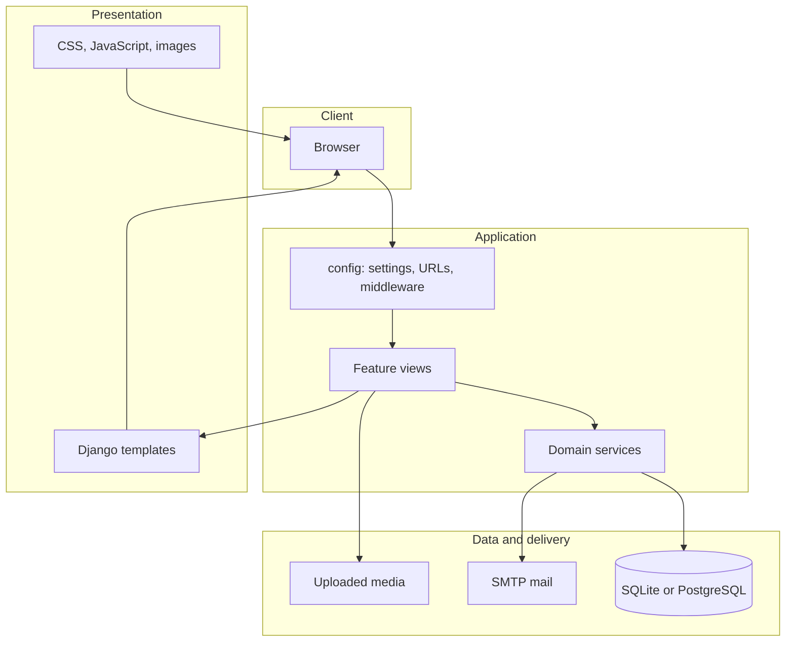
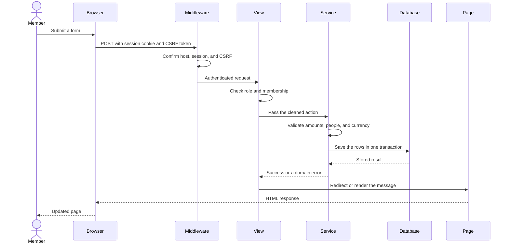

# SplitMate

SplitMate is a shared-expense ledger for people who pay bills together. Each person keeps an account. A bill records who paid, who shares the cost, and how the amount is divided. Balances, repayments, loans, budgets, and reports are calculated from those records.

The product is a Django web application. The browser presents forms and pages. The server checks permissions, calculates every share, and stores the result. SplitMate records that money changed hands. Banks, UPI, and other payment apps stay outside the product.

## Who it is for

- Trips, roommates, students, families, and small teams who need one shared record.
- A person who wants to see what they should receive and what they still owe.
- A developer who needs to run, extend, or deploy the application.

## What a member can do

After sign-in, the menu is grouped into three areas. Every area remains available.

| Area | Pages |
| --- | --- |
| Everyday | Dashboard, All expenses, Friends, Groups, Balances, Settle up |
| Money tools | Recurring, Categories, Budgets, Reports, Informal debts, Templates |
| Account | Notifications, Profile, Settings |

A member can:

- Create an account and sign in afterwards. Registration returns the person to the login page.
- Sign in with a username or an email address. The first successful sign-in sends one welcome message.
- Confirm an email address by choosing **Resend email**. That message is sent only after the member asks for it.
- Reset a forgotten password from the login page. The reset link goes to the address stored on the account.
- Add friends, create groups, and invite people by username or email.
- Give a group member the role of owner, admin, member, or read-only viewer.
- Record an expense with one payer or several payers.
- Split a bill equally, by exact amounts, by percentage, by shares, or item by item.
- Comment on an expense and attach a receipt image.
- Edit an expense when they created it, or when they are an owner or admin of its group.
- Read balances for themselves, for one other person, and for a group.
- Record a repayment and reverse it later. The original repayment remains in the history.
- Keep an informal loan separate from shared bills.
- Save categories, budgets, expense templates, and recurring schedules.
- Open reports and download them as CSV, Excel, or PDF.

## Balance rule

A **positive** balance means that person should receive money. A **negative** balance means that person owes money. **Zero** means that part of the ledger is settled. Group balances and informal loans are kept apart, so one bill is counted once.

One group uses one currency. Amounts in different currencies stay in separate totals.

## How a person starts

1. Open the home page and choose **Create account**.
2. Enter a name, username, email, and a password of at least 6 characters, then accept the terms and privacy policy.
3. Sign in on the next page. The dashboard opens.
4. Add a friend or create a group, then record an expense or a repayment.

**Forgot password** on the login page sends a reset link to the account email.

## High-level design

SplitMate has four layers. Each layer has one job. A user action enters at the top and reaches the database only after the application layer has checked the person and the numbers.



| Layer | Responsibility |
| --- | --- |
| Client | Shows pages, sends forms, and keeps the signed-in session cookie. |
| Presentation | Renders HTML from `templates/` and serves `static/` and uploaded files. |
| Application | Routes the address, checks the session, applies the business rules, and returns the next page. |
| Data and delivery | Stores rows, stores uploads, and sends mail when a feature asks for it. |

`config` is the Django project package. It holds settings, the URL table, middleware, and the server entry points. Feature code lives in `apps`. Each app owns its models, views, and rules. Shared money math lives in `apps/common`, so every feature uses the same split and currency rules.

## Request path

This is the path of one signed-in action, such as saving an expense, recording a repayment, or updating a profile. The same path applies to the other forms.



What each step guarantees:

1. **Browser.** The form includes the CSRF token. A signed-in session identifies the member.
2. **Middleware.** Django rejects an unknown host, a missing token, and an anonymous request to a private page.
3. **View.** The view loads only records that member is allowed to see. A hidden expense or another person's edit returns a not-found response.
4. **Service.** Shares must add up to the bill. A viewer cannot add a group expense. A repayment can be recorded by a participant or by a group admin.
5. **Database.** The write is one transaction. A failed rule leaves the previous rows unchanged.
6. **Page.** The member sees a confirmation, or the same form with the reason the action was refused.

Reading a page uses the same path and stops before a write. Reports read the stored rows and build CSV, Excel, or PDF in the application layer.

Mail is a side step. Welcome mail runs after the first successful sign-in. Password reset and email confirmation run when the member asks for them. A mail failure is logged. Sign-in still completes, and a missed welcome can be sent on a later sign-in.

## Repository map

```text
SplitMate/
  manage.py                 Command entry. Loads config.settings.
  config/                   Project package.
    settings.py             Installed apps, database, mail, security.
    urls.py                 Root URL table.
    wsgi.py                 Production WSGI entry.
    asgi.py                 ASGI entry.
    middleware.py           Request id and member timezone.
  apps/                     Feature applications.
  templates/                HTML for public and signed-in pages.
  static/                   CSS, JavaScript, and images.
  requirements.txt          Python dependencies.
  .env.example              Setting names for a local copy.
  Dockerfile                Container image based on Python 3.14.
  docker-compose.yml        Web and PostgreSQL services.
```

These paths are created on a machine and are excluded from git:

| Path | Contents |
| --- | --- |
| `.env` | Secret key, mail credentials, and host settings. |
| `db.sqlite3` | Local SQLite database, used when `DB_ENGINE` is `sqlite`. |
| `media/` | Profile pictures, group images, and receipt files. |
| `staticfiles/` | Collected static files for a production server. |
| `.venv/` | The local Python environment. |

## Applications

| App | Owns |
| --- | --- |
| `accounts` | Members, passwords, profile, welcome mail, and email confirmation. |
| `friends` | Friend requests, blocks, and invitations by email. |
| `groups` | Groups, membership, roles, and group invitations. |
| `expenses` | Bills, payers, shares, comments, receipts, and templates. |
| `settlements` | Balances, repayments, reversals, and informal loans. |
| `categories` | System categories and categories created by a member. |
| `budgets` | Personal and group spending limits. |
| `recurring` | Schedules that create an expense when the command runs. |
| `reports` | Dashboard, charts, and file exports. |
| `notifications` | In-app notices and optional email notices. |
| `audit` | A record of important changes. |
| `common` | Currencies, split calculations, and the shared money format. |

## Data

Local development stores relational data in `db.sqlite3` in the project folder. Set `DB_ENGINE=postgres` to use PostgreSQL with the `POSTGRES_*` settings. Uploaded files stay in `media/` in both modes.

Open `db.sqlite3` with [DB Browser for SQLite](https://sqlitebrowser.org/), or inspect rows from the project folder:

```powershell
.\.venv\Scripts\python.exe manage.py shell
```

```python
from apps.accounts.models import User
for user in User.objects.order_by("id"):
    print(user.id, user.username, user.email)
```

| Record | Table |
| --- | --- |
| Member, email, password hash, currency | `accounts_user` |
| Friend link | `friends_friendship` |
| Group and membership | `groups_group`, `groups_groupmembership` |
| Expense, payer, and share | `expenses_expense`, `expenses_expensepayer`, `expenses_expenseshare` |
| Repayment | `settlements_settlement` |
| Informal loan | `settlements_informaldebt` |
| Category, budget, and schedule | `categories_expensecategory`, `budgets_budget`, `recurring_recurringexpense` |
| Notification | `notifications_notification` |

Passwords are stored as hashes. Account deletion anonymizes the member row so older bills keep a stable person.

## Security

- Private pages require a signed-in session.
- State-changing forms require a CSRF token.
- Login attempts are throttled.
- The password rule is a minimum of 6 characters.
- Session cookies are HTTP-only. Secure cookies are used when debug is off.
- Receipt downloads are limited to members who can view that expense.
- Mail credentials are read from the environment. They belong in `.env`, which git ignores.

## Run it from scratch

Requirements: Python 3.14 and PowerShell or another terminal. From a new clone:

```powershell
git clone https://github.com/Ganesh2325/SplitMate.git
cd SplitMate
python -m venv .venv
.\.venv\Scripts\python.exe -m pip install -r requirements.txt
copy .env.example .env
.\.venv\Scripts\python.exe manage.py migrate
.\.venv\Scripts\python.exe manage.py runserver 127.0.0.1:8001
```

Open http://127.0.0.1:8001/ and create an account.

Fill `.env` before relying on mail. `EMAIL_HOST_USER` is the sending mailbox. `EMAIL_HOST_PASSWORD` is a Gmail app password for that mailbox. Messages are delivered to each member's own address. Leave both values empty in any file that is committed.

Useful checks:

```powershell
.\.venv\Scripts\python.exe manage.py check
.\.venv\Scripts\python.exe manage.py test
```

`GET /health/` returns `{"status": "ok"}` when the database accepts a query.

## Operations

| Command | Purpose |
| --- | --- |
| `process_recurring_expenses` | Create due expenses from active schedules. A second run on the same day does not duplicate a bill. |
| `send_repayment_reminders` | Email reminder notices where the member has allowed them. |
| `purge_login_attempts` | Remove old login-attempt rows. |
| `reconcile_balances` | Recalculate stored balance figures from expenses and repayments. |

Run a command with:

```powershell
.\.venv\Scripts\python.exe manage.py process_recurring_expenses
```

Recurring bills are created by this command, or by a scheduler that runs it. The web process does not create them in the background.

## Production

Set these in the environment:

| Setting | Production value |
| --- | --- |
| `DJANGO_DEBUG` | `false` |
| `DJANGO_SECRET_KEY` | A long random string |
| `DJANGO_ALLOWED_HOSTS` | The public host name |
| `SITE_BASE_URL` | The public `https://` origin |
| `DB_ENGINE` | `postgres` |
| `CSRF_TRUSTED_ORIGINS` | The public `https://` origin |
| `ENABLE_HSTS` | `true` only after HTTPS is working |

Staff tools are at `/admin/`. Change bills and repayments through the product pages so the share rules and the audit history stay intact.

The `Dockerfile` and `docker-compose.yml` files start Gunicorn and PostgreSQL. Treat them as a starting point and verify them in the target environment before relying on them.

Receipt text extraction stays off unless `ENABLE_OCR` is enabled in an environment where that dependency is installed.
